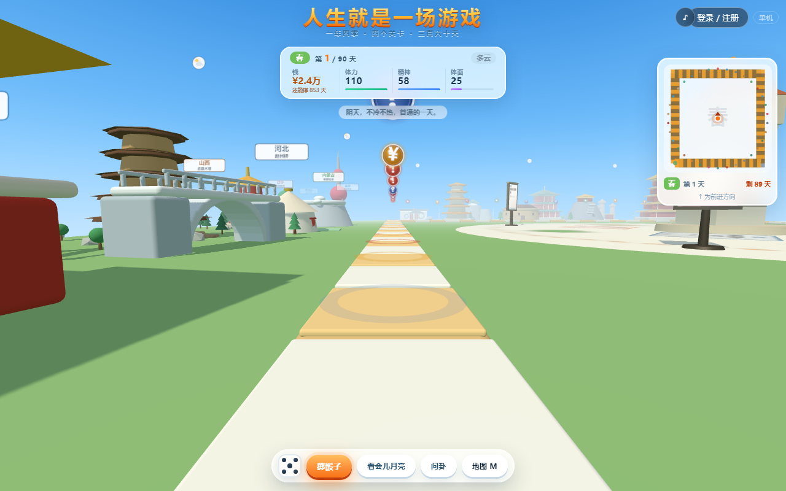
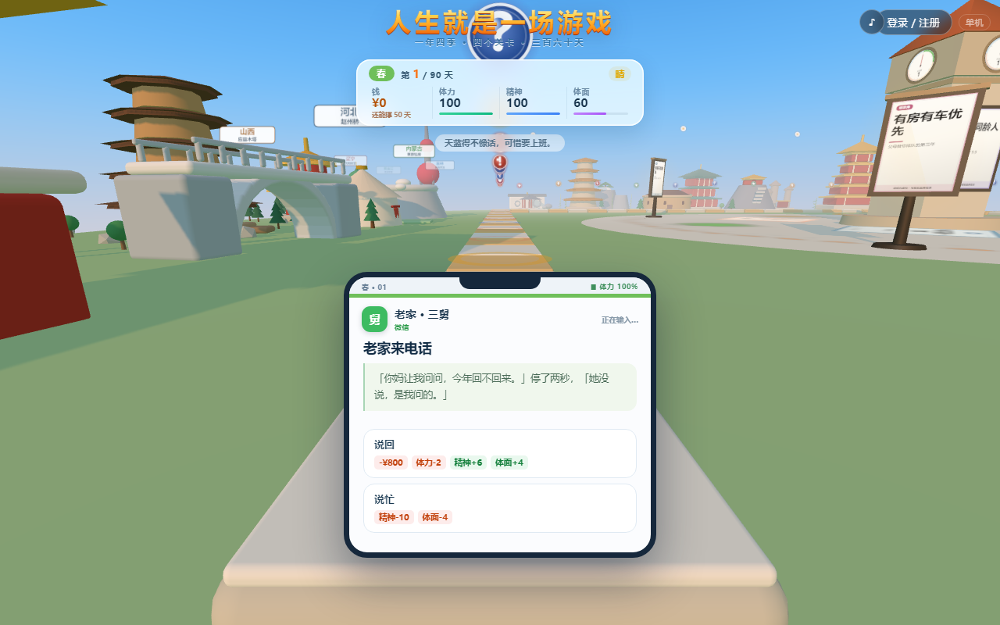

# 人生就是一场游戏

一个跑在浏览器里的 3D 人生模拟游戏。掷骰子走过 90 格，四季轮转，赚钱、上班、生病、被人催、被人借、做选择。

一局结束会清算善恶：**一件坏事没做过，上天庭；做过，去地府走一趟孽镜台。**



---

## 玩法

一局 90 天，春夏秋冬四季轮转。每天掷一次骰子，落到格子上触发事件。

你手上有四个数：

| 数值 | 说明 |
|---|---|
| 钱 | 会涨会跌，能欠债 |
| 体力 | 归零会倒下 |
| 精神 | 归零会崩溃 |
| 体面 | 别人怎么看你，影响事件走向 |

事件给三个选项，没有标准答案。有的选项赚了钱但结了恶业，有的赔了钱但保住了体面。**恶业会在后半程以"报应牌堆"的形式回来找你。**

死亡（体力或精神归零）后进入结局：

- 恶业为零 → 天庭，受封掌福 / 掌寿 / 掌明
- 有恶业 → 地府，孽镜台逐条对账 → 孟婆桥喝不喝 → 六道轮回选一道

---

## 一些实现细节

**332 条事件**，分布在生活、工作、季节、命运、报应五类牌堆里，全部原创文案，共 997 个选项。

**21 种身份**（无业游民、流水线工人、网约车司机、程序员、创业者、退休教师……），各有独立的初始数值、事件池和收入曲线。

**事件不是都长一个样。** 现实里的麻烦有不同的到达方式，所以卡片也分载体：

| 载体 | 用在哪 | 长什么样 |
|---|---|---|
| 街面 | 你亲眼看见的事 | 原样，不加壳 |
| 钉钉 | 工作、甲方、领导 | 蓝色头像 + 「抄送 6 人」 |
| 微信 | 家人、亲戚、同学 | 绿色气泡 + 「正在输入…」 |
| 短信 | 催收、诈骗、公检法 | 灰色 + 「第 3 次未接」 |
| 银行 | 账单、券商、彩票 | 红色 + 「自动扣款失败」 |
| 医院 | 体检、急诊 | 青色 + 「建议复查」 |

判定分三层：先看在不在现场，再走约 40 条规则表，最后兜底原样。**房东在门口等你是当面的事，房东发消息说要涨租才是消息** —— 只按主语匹配会让这两件事长得一模一样。

**界面会累。** 体力和精神低到一定程度，界面自己会垮：

| 档位 | 触发 | 变化 |
|---|---|---|
| 疲惫 | 体力 < 35% 或 精神 < 45% | 数字偶尔闪一下 |
| 撑不住 | 体力 < 20% 或 精神 < 30% | 圆角变方、阴影消失、数字转灰、按钮按下慢半拍 |
| 空 | 两个都 < 15% | **四个数字全部变成「——」** |

最后一档是故意的：不是数字变红提醒你快撑不住了，而是你连自己还剩多少都看不见。



**其余玩法**：改命（用恶业买重掷）、命运卡组（开局 12 选 3）、因果债（跟别的玩家借命，要还）、全服善恶天平（全体玩家的善恶决定世界属阴还是属阳）、每日一命（全球同种子同随机数）、图鉴、墓志铭、善业挡灾、六道轮回。

---

## 快速开始

### 只玩本体（纯前端，无需后端）

```bash
git clone https://github.com/weixinoss/life-is-a-game.git
cd life-is-a-game
# 任选一个静态服务器，或直接双击 index.html
python -m http.server 8000
```

打开 `http://localhost:8000/` 即可。**本体不依赖后端**，存档在浏览器 localStorage 里，单机可玩全部内容。

> 直接双击 `index.html`（`file://`）也能跑。起服务器只是为了避免个别浏览器对本地文件的限制。

### 要联网玩法（账号、存档云同步、排行、全服天平）

需要 PHP 8.2+ 与 MySQL 5.7+：

1. 把整个 `server/` 上传到网站根目录
2. 浏览器打开 `/server/install.php`，按提示填数据库信息
3. 装完删掉 `install.php`

安装器会建 28 张表、生成 `server/lib/config.php`、创建管理员、写安装锁。详见 [server/README.md](server/README.md)。

未安装时前台仍可正常单机游玩，只是不连账号。

---

## 项目结构

```
index.html              主界面（样式内联在此）
main.js                 3D 场景入口
difu.html               地府结算界面
tiangong.html           天庭结算界面
js/
  life/                 35 个前端模块，按编号顺序加载
    40-data-jobs.js     21 种身份
    60~66-events-*.js   332 条事件
    70~77-board*.js     棋盘与格子
    82-state-hud.js     数值 HUD 与界面退化
    87-turn.js          回合推进
    97-event-veil.js    事件载体映射
  net/                  联网层：会话、同步、三界分流、审判
server/                 PHP 后端，无框架无 Composer
  install.php           一键安装向导
  api/index.php         全部接口
  admin/                独立后台
  sql/schema.sql        28 张表
docs/                   说明文档与界面截图
vendor/                 three.js r161 与后处理
```

---

## 技术栈

- 前端：原生 JS + Three.js（ES Module），**无框架、无构建、无 npm 依赖**
- 后端：PHP 8.2 + MySQL 5.7，单目录部署，PDO 直连
- 渲染：Three.js + UnrealBloom 后处理，昼夜与四季切换靠色温插值

没有构建步骤是刻意的：`index.html` 打开就能跑，改完刷新即见效。

---

## 关于代码可读性（先说清楚）

**前端的标识符是短名，比如 `C`、`Zh`、`Ux`、`Mc`。** 这些文件是从一份单行压缩代码机械还原出来的：缩进和换行恢复了，名字没敢改（没有 source map，重命名容易造成语义漂移）。

所以你打开 `87-turn.js` 会看到 `Zh.textContent = ...` 这种写法，不查就能猜到，但读起来确实累。

已知的几个坑：

- 新起全局标识符前**必须先 grep**。`Qx` 这种两字母组合极可能已被占用，重名会让运行时静默出错
- 样式大量内联在 `index.html` 的 `<style>` 里，没有独立样式表
- 三界（主界面 / 地府 / 天庭）目前各自一套视觉语言，尚未收敛成设计 token

这些都在陆续收拾。如果你想参与，从新增事件或新增身份入手最安全——那两块是纯数据，不碰运行时。

---

## 第三方组件

| 组件 | 版本 | 许可 |
|---|---|---|
| [Three.js](https://threejs.org/) | r161 | MIT |
| OrbitControls / EffectComposer 等 | 同 r161 | MIT |
| [ip2region](https://github.com/lionsoul2014/ip2region) 离线 IP 库 | v1.9.0 | Apache-2.0 |

`server/lib/geoip_data.php` 由 ip2region 的 `ip.merge.txt` 生成（4.1 万段区间表），依 Apache-2.0 使用，未修改原始数据。

## 许可

[MIT](LICENSE)
